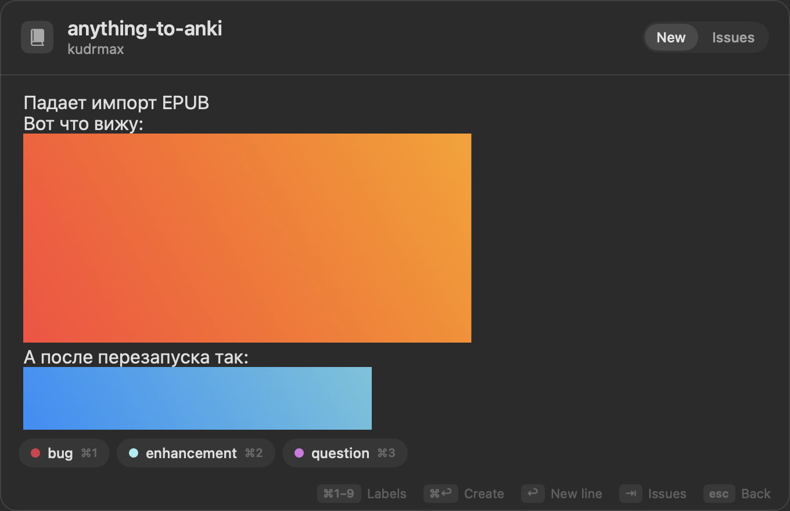
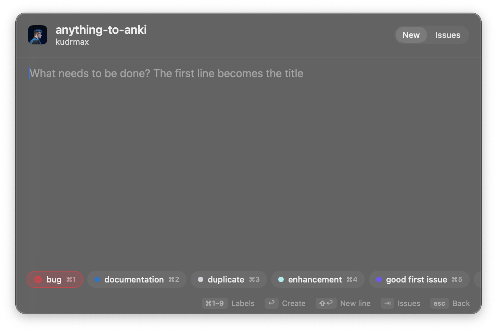
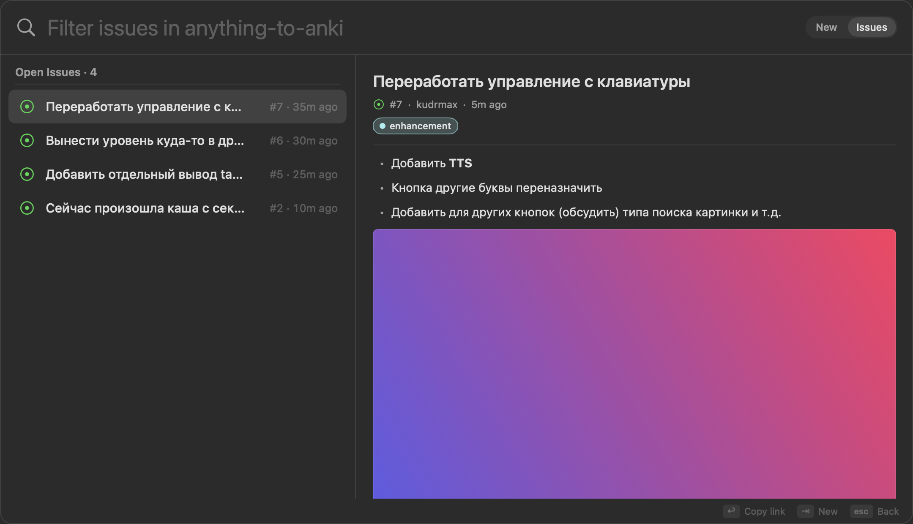

# IssueBar

Мини-приложение в menu bar для быстрого создания и просмотра GitHub issues. Работает поверх `gh`, авторизация берётся из `gh auth login`.



## Требования

- macOS 14+, Xcode или Command Line Tools со Swift 6
- [GitHub CLI](https://cli.github.com): `brew install gh`, затем `gh auth login`

## Сборка

```bash
./scripts/build-app.sh            # собрать build/IssueBar.app
./scripts/build-app.sh --install  # собрать, положить в ~/Applications и запустить
swift test                        # тесты (core, редактор, модель окна, снимки)
./scripts/make-icon.sh            # перерисовать иконку (scripts/make-icon.swift)
```

## Управление

| Где | Клавиша | Действие |
|---|---|---|
| везде | ⌃⌥I | открыть / закрыть |
| везде | ⇥ | переключить «Создать» / «Задачи» |
| список репо | ↑ ↓, ↩ | выбрать репозиторий |
| редактор | ⌘↩ | создать issue (ссылка копируется в буфер) |
| редактор | ↩ | перенос строки |
| редактор | ⌘1–⌘9 или клик | включить или выключить метку |
| задачи | ↑ ↓ | выбрать issue, справа его содержание |
| задачи | ↩ или клик | скопировать ссылку на issue |
| везде | ⌘W | закрыть окно |
| везде | ⌘Q | выйти из приложения |
| везде | esc | назад / закрыть |

Первая строка текста становится заголовком, остальное уходит в описание. Если текст начинается с картинки, заголовком станет первая строка текста после неё.



## Просмотр issue

В режиме «Issues» окно расширяется и делится на две части: слева список открытых issue с фильтром, справа содержание выбранного — заголовок, автор, метки, текст с форматированием (списки, заголовки, код, цитаты, ссылки) и картинки. Картинки из ветки `issue-attachments` грузятся с токеном `gh`, поэтому видны и в приватных репо. Картинки, загруженные через сайт GitHub, берутся по подписанным ссылкам из HTML-версии issue. Комментарии пока не показываются.



## Картинки

⌘V вставляет картинку прямо в место курсора: текст и картинки чередуются в любом порядке. Принимаются скриншоты, картинки из браузера и файлы изображений, скопированные в Finder.

У GitHub нет публичного API для вложений в issue, поэтому при отправке картинки коммитятся в отдельную ветку `issue-attachments` того же репозитория. У этой ветки нет общей истории с основными, они не меняются. В тексте issue картинки вставляются ссылками на место, где были в редакторе. Видят их все, у кого есть доступ к репозиторию. Нужны права на push в репо.

## Устройство

- `IssueBarCore` — модели, работа с `gh`, поиск и сортировка, хранение. От UI не зависит.
- `IssueBar` — AppKit/SwiftUI: панель, глобальный шорткат, иконка в menu bar, редактор с картинками.
- Тесты интерфейса работают вне экрана: редактор с приватным буфером обмена, окно, которое никогда не показывается. Клавиатуру и фокус они не трогают.
