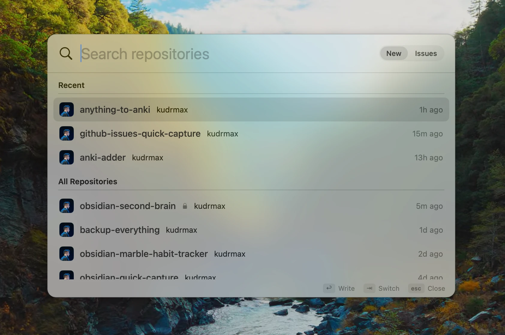
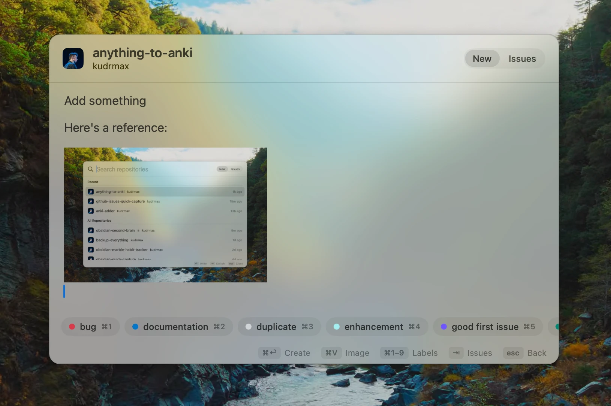
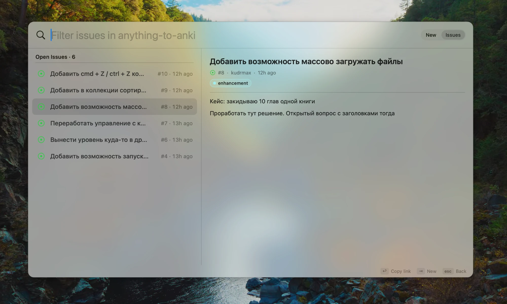

# IssueBar

A tiny menu bar app for quickly creating and browsing GitHub issues. It runs on top of `gh` and uses the auth from `gh auth login`.

Pick a repository:



Write an issue with images and labels:



Browse open issues:



## Requirements

- macOS 14+, Xcode or Command Line Tools with Swift 6
- [GitHub CLI](https://cli.github.com): `brew install gh`, then `gh auth login`

## Build

```bash
./scripts/build-app.sh            # build build/IssueBar.app
./scripts/build-app.sh --install  # build, copy to ~/Applications and launch
swift test                        # tests (core, editor, window model, snapshots)
./scripts/make-icon.sh            # redraw the icon (scripts/make-icon.swift)
```

## Controls

| Where | Key | Action |
|---|---|---|
| anywhere | ⌃⌥I | open / close |
| anywhere | ⇥ | switch between New and Issues |
| repository list | ↑ ↓, ↩ or → | pick a repository |
| editor | ⌘↩ | create the issue (its link is copied to the clipboard) |
| editor | ↩ | new line |
| editor | ⌘1–⌘9 or click | toggle a label |
| issues | ↑ ↓ | select an issue, its content shows on the right |
| issues | ↩ or click | copy the issue link |
| issues | ← | back to the repository list |
| anywhere | ⌘W | close the window |
| anywhere | ⌘Q | quit the app |
| anywhere | esc | back / close |
| outside the window | click | close |

← and → switch screens only when the cursor in the search field is at the edge of the text: ← at the start, → at the end. Otherwise they move the cursor as usual.

The window closes like Spotlight: on a click outside it or when you switch to another app. Whatever you typed is kept until the next time you open it. Windows floating above others, such as the Maccy clipboard, Raycast or Alfred, don't close it, so you can paste from them.

The first line of text becomes the title, the rest goes into the description. If the text starts with an image, the title is the first line of text after it.

## Viewing issues

In Issues mode the window widens and splits in two: on the left, the list of open issues with a filter; on the right, the selected issue: title, author, labels, formatted text (lists, headings, code, quotes, links) and images. Images from the `issue-attachments` branch are loaded with the `gh` token, so they show up in private repositories too. Images uploaded through the GitHub website are fetched via signed links from the HTML version of the issue. Comments are not shown yet.

### Cache

- **Images** are cached on disk (`~/Library/Caches/IssueBar/Images`) with no expiry: an image at a given URL never changes, and replacing an image in an issue gives it a new URL. For GitHub signed links the signature is not part of the key. The limit is 200 MB, old entries are evicted automatically. To clear it: right-click the menu bar icon → Clear Image Cache.
- **Issue content** is cached on disk (`~/Library/Caches/IssueBar/Issues`) and survives app restarts. It is checked against `updatedAt` from the list, which reloads every time Issues mode opens. If an issue was edited, it is fetched again, and the old version stays on screen until then.

## Images

⌘V pastes an image right at the cursor: text and images can alternate in any order. Screenshots, images from a browser and image files copied in Finder all work.

GitHub has no public API for issue attachments, so on submit the images are committed to a separate `issue-attachments` branch of the same repository. That branch shares no history with the main ones, which stay untouched. In the issue text the images become links placed where they were in the editor. Anyone with access to the repository can see them. Push access to the repository is required.

## Architecture

- `IssueBarCore`: models, `gh` integration, search and sorting, storage. Independent of the UI.
- `IssueBar`: AppKit/SwiftUI: the panel, the global shortcut, the menu bar icon, the editor with images.
- UI tests run offscreen: an editor with a private pasteboard and a window that is never shown. They don't touch the keyboard or focus.
